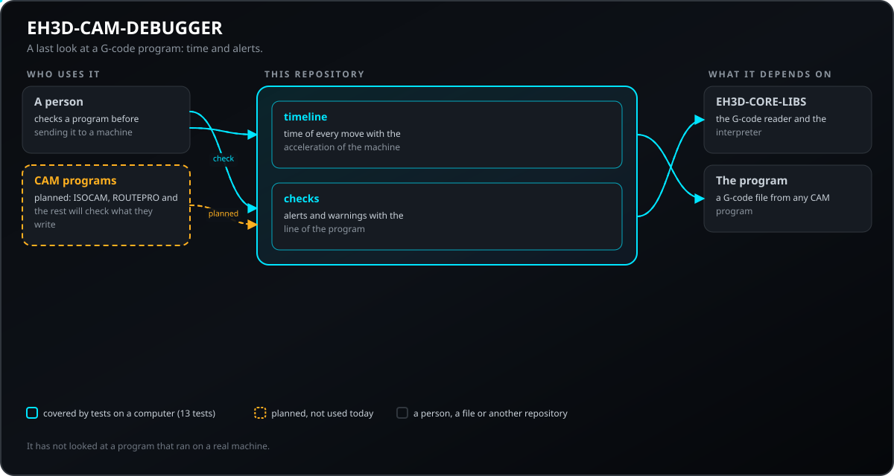
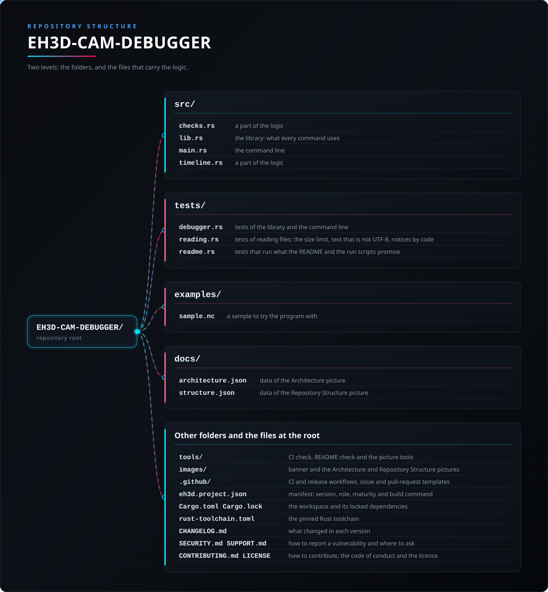

<p align="center">
  
</p>

# 📖 EH3D-CAM-DEBUGGER

<p align="center">🇺🇸 <b>English</b> | <a href="README_spa.md">🇪🇸 Español</a> | <a href="README_fra.md">🇫🇷 Français</a> | <a href="README_ita.md">🇮🇹 Italiano</a> | <a href="README_deu.md">🇩🇪 Deutsch</a> | <a href="README_zho.md">🇨🇳 中文</a> | <a href="README_jpn.md">🇯🇵 日本語</a> | <a href="README_por.md">🇵🇹 Português</a></p>

### The last look at a G-code program before it reaches a machine: time and alerts

<p align="center">
  
  
  
  
  
</p>

---

**Honesty check - what actually runs today:** a Rust library and a command line program (`eh3d-camdebug`) with 48 tests that run on a computer: works out the time of a G-code program and finds rapid moves into the material, moves outside the table, cuts with the spindle off and heads over clamps. It has no window yet, it has not been tried on a machine and it has not been checked against a collection of real files.

---

> **Safety and security status:** this program does not control any machine and is not a safety system. What it produces must be checked by a person before anything is run on a machine; nothing here has run on real hardware.


## 📋 At a glance

| | |
|---|---|
| Version | `0.0.3` |
| Maturity | Scaffolding |
| Tests | 48 |
| Stack | Rust |
| On real hardware | Not tried: nothing here has run on a machine |

**Jump to:** [Overview](#-overview) · [Architecture](#-architecture) · [Quick start](#-quick-start) · [Testing](#-testing) · [Structure](#-repository-structure) · [Related](#-related-projects)

## 🚦 Project status

Each line is one part of this repository and the light says how far it is today. It is written from what the repository can show (tests, builds, runs), not from what is planned.

🟢 Done and verified · 🟡 Works, with known limits · 🟠 Partly done or not verified yet · 🔴 Not done or not working

| Area | State | What it means here |
|---|---|---|
| Core | 🟡 | works out the time of a G-code program and finds rapid moves into the material, moves outside the table, cuts with the spindle off and heads over clamps; tested on a computer with normal and damaged input, not with a collection of real files. |
| Command line | 🟡 | `eh3d-camdebug` runs the same functions as the library and prints the result; every error comes back as a message and a non-zero exit code. |
| Tests | 🟡 | 48 tests pass (`cargo test`), with normal cases, edge cases and damaged input. |
| Security | 🟡 | Plain safe Rust (`forbid(unsafe_code)`): nothing panics on the files it is given and a bad value is an error with its reason; no independent review. |
| Window | 🔴 | Planned: the egui window common to the suite; today there is only the command line. |
| Real hardware | 🔴 | Not tried: nothing here has been run on a machine. |
| Documentation | 🟡 | README in eight languages, the changelog and the two pictures drawn from `docs/`. |

## 🎯 Overview

* **The time** (`src/timeline.rs`): every move is a trapezoid of speed from rest to rest with the acceleration and the rapid speed of the machine; the arcs are measured along the arc, a cut with no feed uses a default one, and the total is split in cutting and rapid. It is an upper bound: a real controller does not stop between moves.
* **The alerts** (`src/checks.rs`): a rapid move (G0) into the material or sideways below the surface, a move outside the table, a Z below the lowest one of the machine, and a head that passes over a clamp below its height are alerts (exit code 1); a cut with the spindle off, a cut with no feed and a feed above a limit are warnings. A straight move is tested exactly against each clamp, so a clamp thinner than any step is still found.
* **What the reader could not understand** (cutter compensation, canned cycles, a damaged line) comes up as an alert with its line, so a program that was misread is never reported as clean.
* **Arcs, `--strict` and the codes that move the origin:** the table limits and the clamps are tested along the arc of a G2 or G3, not along its chord; `--strict` makes every warning an alert (exit code 1), for a flow that uses the exit code as the barrier before the machine; a program with G92, G53, G28, G30 or G10 is reported instead of passing as clean.
* **Reading and notices by code:** the program is read from its bytes (`--max-bytes N` refuses a file over the limit, 256 MiB by default; text that is not UTF-8 is read as Latin-1 and reported with the code `input-not-utf8`); every finding of the reader shows its stable code, and `--ignore CODE[,CODE]` leaves out the notices of those codes.

## 🧩 Role in EH3D

EH3D-CAM-DEBUGGER is one program of the EH3D Fabrication Suite. Today it works as a library and a command line; its window, in the look the other programs of the suite share, is planned. It reads and writes plain files, so it can be used on its own or between the other programs.

## 🏛️ Architecture

<p align="center">
  
</p>


How the parts of this repository fit together: who uses it, what it holds and what it depends on. The picture is drawn from `docs/architecture.json` and checked against the code.

## ✨ Features

* **A library and a command line:** every command of `eh3d-camdebug` is a function of the library, so another program of the suite can call it without starting a process.
* **Tests with damaged input:** the tests also feed empty files, garbage, huge numbers and cut files, and none of them may panic.
* **No guessing:** a value that does not make sense is an error that says which value and why, never a result that only looks right.
* **No unsafe code:** `#![forbid(unsafe_code)]` in the library and the program.

## 🔒 Security & Safety

| Threat | Defense |
|---|---|
| A damaged, truncated or empty file | no panic: the tests cut valid input at every position and feed garbage |
| A number that makes no sense (negative, not finite, absurdly large) | refused with an error that names the value; nothing is rounded into something plausible |
| Unsafe memory use | plain safe Rust with `forbid(unsafe_code)` |

**What is not defended:** a result that was produced cleanly is not a verified result. Nothing here knows the limits of a machine, and the program has had no independent review. Report a vulnerability privately (see [SECURITY.md](SECURITY.md)).

## 🔌 Interfaces

The library is `eh3d_cam_debugger` (`use eh3d_cam_debugger::...`); the command line is `eh3d-camdebug`. The commands are these; each prints its result on the standard output and reports an error on the standard error with a non-zero exit code. There is no network access.

```text
EH3D-CAM-DEBUGGER/
├── src/
│   ├── checks.rs                                a part of the logic
│   ├── lib.rs                                   the library: what every command uses
│   ├── main.rs                                  the command line
│   └── timeline.rs                              a part of the logic
├── tests/
│   ├── debugger.rs                              tests of the library and the command line
│   ├── reading.rs                               tests of reading files: the size limit, text that is not UTF-8, notices by code
│   └── readme.rs                                tests that run what the README and the run scripts promise
├── examples/
│   └── sample.nc                                a sample to try the program with
├── docs/
│   ├── architecture.json                        data of the Architecture picture
│   └── structure.json                           data of the Repository Structure picture
├── tools/                                       CI check, README check and the picture tools
├── images/                                      banner and the Architecture and Repository Structure pictures
├── .github/                                     CI and release workflows, issue and pull-request templates
├── eh3d.project.json                            manifest: version, role, maturity and build command
├── Cargo.toml Cargo.lock                        the workspace and its locked dependencies
├── CHANGELOG.md                                 what changed in each version
├── SECURITY.md SUPPORT.md                       how to report a vulnerability and where to ask
└── CONTRIBUTING.md CODE_OF_CONDUCT.md LICENSE   how to contribute, the code of conduct and the licence
```

## ⚙️ Configuration

There is no configuration file yet: what a person chooses is given as arguments of the command line (see Interfaces) and every default is written in the help of the command (`eh3d-camdebug help`). The fixed limits live in the code as named constants and are covered by tests.

## 🚀 Quick start

You need a stable Rust toolchain (1.75 or newer).

```bash
cargo build --release
cargo test
cargo run --release -- check examples/sample.nc --table 100,80 --clamp 20,-5,30,5,6
```

## 🧪 Testing

The suite has 48 tests (`cargo test`, run on Windows and Linux in the CI). They check the normal cases, the edge cases and damaged input: empty files, garbage and cut files never panic. The CI also runs `cargo fmt --check`, `cargo clippy` with warnings as errors and `python -I tools/ci_validate.py`.

## 🏗️ Build & Release

The version lives in `Cargo.toml` and in `eh3d.project.json`; each version has its entry in [CHANGELOG.md](CHANGELOG.md). `build.bat` / `build.sh` build the program, `test.bat` / `test.sh` run the tests and `run.bat` / `run.sh` run it with a sample. Releases are published on GitHub.

## 📂 Repository Structure

<p align="center">
  
</p>

<details>
<summary>Text version of the tree</summary>

```text
EH3D-CAM-DEBUGGER/
├── crates/
│   ├── eh3d-parser-gerber/                      Gerber RS-274X reader
│   ├── eh3d-parser-excellon/                    Excellon drill file reader
│   └── eh3d-parser-gcode/                       G-code reader and modal interpreter
├── docs/                                        READERS.md, what every reader promises and what it does not do, and the data of the two pictures
├── tools/                                       CI check, README check and the picture tools
├── images/                                      banner and the Architecture and Repository Structure pictures
├── .github/                                     CI and release workflows, issue and pull-request templates
├── eh3d.project.json                            manifest: version, role, maturity and build command
├── Cargo.toml Cargo.lock                        the workspace and its locked dependencies
├── CHANGELOG.md                                 what changed in each version
├── SECURITY.md SUPPORT.md                       how to report a vulnerability and where to ask
└── CONTRIBUTING.md CODE_OF_CONDUCT.md LICENSE   how to contribute, the code of conduct and the licence
```

</details>

## 🗺️ Roadmap & Known limits

**Known limits today**

* It has no window yet: only the library and the command line exist.
* It has not been tried on a machine nor with a collection of real files, and it has had no independent review.
* There is no 3D simulation or removal of material yet, and the clamps are boxes you describe by hand.

**Next**

* Simulate the removal of material in 3D and compare the result with the part, with the window of the suite.
* Add the window in the look shared by the programs of the suite, in the eight languages.
* Try it with real files and with the other programs of the suite.

## 🌍 Languages

README and texts exist in English, Spanish, French, Italian, German, Chinese, Japanese and European Portuguese.

## 🔗 Related Projects

* [EH3D-CORE-LIBS](https://github.com/JuanenRac/EH3D-CORE-LIBS): the readers of Gerber, Excellon and G-code
* [EH3D-ISOCAM](https://github.com/JuanenRac/EH3D-ISOCAM): isolation milling of copper
* [EH3D-ROUTEPRO](https://github.com/JuanenRac/EH3D-ROUTEPRO): the contour milling program
* [EH3D-AUTOLEVEL](https://github.com/JuanenRac/EH3D-AUTOLEVEL): the height map and the correction of G-code
* [EH3D-MOTIONCNC](https://github.com/JuanenRac/EH3D-MOTIONCNC): the machine control program

## 📚 Documentation

* [Changelog](CHANGELOG.md)
* [Architecture and structure data](docs/architecture.json): the data the two pictures are drawn from.

## 🤝 Contributing & Community

* Before a pull request run `cargo fmt --check`, `cargo clippy --all-targets -- -D warnings`, `cargo test` and `python -I tools/ci_validate.py`: all must pass. See [CONTRIBUTING.md](CONTRIBUTING.md) and the [code of conduct](CODE_OF_CONDUCT.md).
* The README exists in eight languages: a change to the text is made in all eight files, and the two pictures are drawn from `docs/architecture.json` and `docs/structure.json` by `tools/make_architecture.py` and `tools/make_structure.py`.
* Report a vulnerability privately: [SECURITY.md](SECURITY.md). Questions, ideas and reports: electrohobby3d@gmail.com ([SUPPORT.md](SUPPORT.md)).

## 👤 AUTHOR

**JuanenRac (Electro Hobby 3D)** · electrohobby3d@gmail.com

## 📜 LICENSE

Software: GPL-3.0-or-later. See [LICENSE](LICENSE). Hardware designs of the suite use CERN OHL-S.
