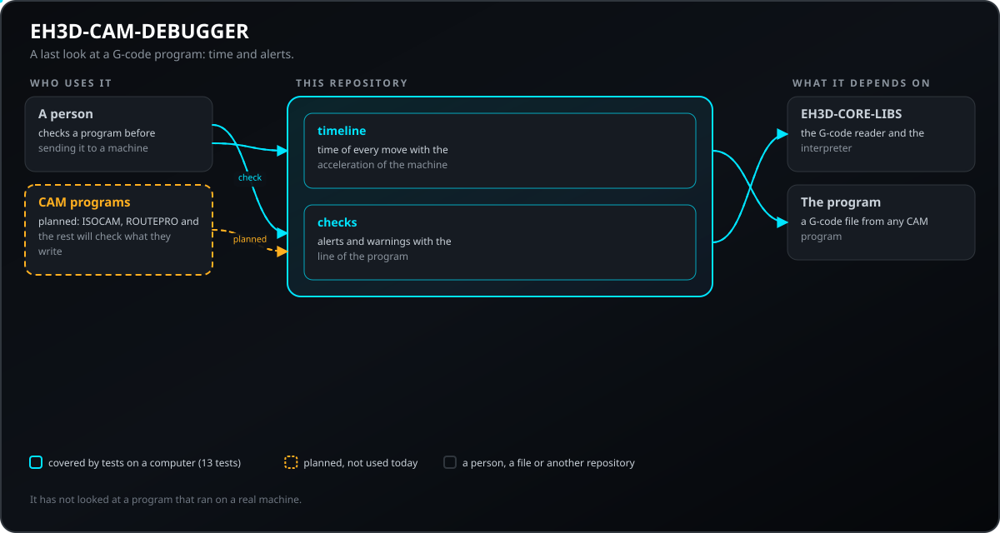
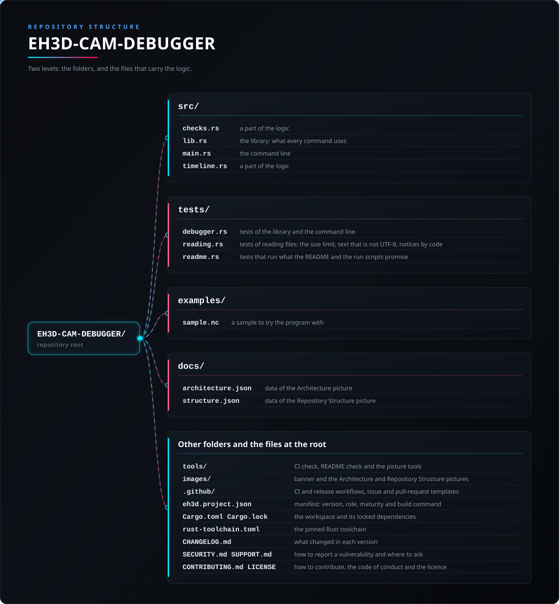

<p align="center">
  
</p>

# 📖 EH3D-CAM-DEBUGGER

<p align="center"><a href="README.md">🇺🇸 English</a> | <a href="README_spa.md">🇪🇸 Español</a> | <a href="README_fra.md">🇫🇷 Français</a> | <a href="README_ita.md">🇮🇹 Italiano</a> | <a href="README_deu.md">🇩🇪 Deutsch</a> | <a href="README_zho.md">🇨🇳 中文</a> | 🇯🇵 <b>日本語</b> | <a href="README_por.md">🇵🇹 Português</a></p>

### 機械に届く前の G コード プログラムの最終確認：時間と警告

<p align="center">
  
  
  
  
  
</p>

---

**正直さの確認 - 現在実際に動くもの：** Rust ライブラリとコマンドライン プログラム（`eh3d-camdebug`）で、コンピューター上で実行される 46 件のテストがあります：G コード プログラムの時間を計算し、材料への早送り、テーブル外の移動、主軸停止での切削、クランプ上を通るヘッドを見つけます。ウィンドウはまだなく、機械では試しておらず、実際のファイルの集まりでも確認していません。

---

> **安全とセキュリティの状況：** このプログラムは機械を制御せず、安全システムでもありません。出力は、機械で何かを実行する前に人が確認する必要があります。ここにあるものは実機で動かしたことがありません。


## 📋 ひと目で

| | |
|---|---|
| バージョン | `0.0.3` |
| 成熟度 | 足場 |
| テスト | 46 |
| 技術スタック | Rust |
| 実機での動作 | 未試験：ここにあるものは機械で動かしたことがありません |

**移動先：** [概要](#-概要) · [アーキテクチャ](#-アーキテクチャ) · [クイックスタート](#-クイックスタート) · [テスト](#-テスト) · [構成](#-リポジトリの構成) · [関連](#-関連プロジェクト)

## 🚦 プロジェクトの状況

各行はこのリポジトリの一部分で、信号は今日どこまで進んでいるかを示します。計画ではなく、リポジトリが示せるもの（テスト、ビルド、実行）に基づいて書かれています。

🟢 完了・検証済み · 🟡 動作する（既知の制限あり） · 🟠 一部のみ、または未検証 · 🔴 未実装または動作しない

| 領域 | 状態 | ここでの意味 |
|---|---|---|
| コア | 🟡 | G コード プログラムの時間を計算し、材料への早送り、テーブル外の移動、主軸停止での切削、クランプ上を通るヘッドを見つけます。コンピューター上で通常入力と破損入力でテスト済み。実際のファイルの集まりでは未確認。 |
| コマンドライン | 🟡 | `eh3d-camdebug` はライブラリと同じ関数を実行して結果を表示します。エラーはメッセージと 0 以外の終了コードで返ります。 |
| テスト | 🟡 | 46 件のテストが通ります（`cargo test`）。通常ケース、境界ケース、破損入力を含みます。 |
| セキュリティ | 🟡 | 安全な Rust のみ（`forbid(unsafe_code)`）。受け取ったファイルでパニックせず、不正な値は理由付きのエラーになります。独立したレビューはありません。 |
| ウィンドウ | 🔴 | 予定：スイート共通の egui ウィンドウ。現在はコマンドラインのみです。 |
| 実機 | 🔴 | 未試験：ここにあるものは機械で実行したことがありません。 |
| ドキュメント | 🟡 | 8 言語の README、変更履歴、`docs/` から描いた 2 枚の図。 |

## 🎯 概要

* **時間**（`src/timeline.rs`）：各移動は、機械の加速度と早送り速度による停止から停止までの速度台形として計算します。円弧は弧に沿って測り、送りのない切削は既定値を使い、合計は切削と早送りに分けます。実際のコントローラーは移動間で止まらないため、上限値です。
* **警報**（`src/checks.rs`）：材料内への早送り（G0）や表面下での横移動、テーブル外への移動、機械の最低 Z より下の Z、高さより低くクランプの上を通るヘッドは警報（終了コード 1）です。主軸停止での切削、送りなしの切削、上限を超える送りは警告です。
* **リーダーが理解できなかったもの**（工具径補正、固定サイクル、壊れた行）は行番号付きの警報として現れるため、誤読されたプログラムが問題なしと報告されることはありません。
* **円弧、`--strict`、原点を動かすコード：** テーブルの範囲とクランプは、G2・G3 の弦ではなく円弧に沿って検査されます。`--strict` はすべての警告をアラートにし（終了コード 1）、終了コードを機械の前の関門にする運用で使えます。G92、G53、G28、G30、G10 を含むプログラムは、問題なしとして通らず報告されます。
* **読み込みとコード別の通知：** プログラムはバイト列から読み込まれます（`--max-bytes N` は上限（既定 256 MiB）を超えるファイルを拒否し、UTF-8 でないテキストは Latin-1 として読み、コード `input-not-utf8` で報告します）。リーダーの指摘はそれぞれ安定したコードを示し、`--ignore CODE[,CODE]` でそのコードの通知を省けます。

## 🧩 EH3D での役割

EH3D-CAM-DEBUGGER は EH3D Fabrication Suite のプログラムの一つです。現在はライブラリとコマンドラインとして動作し、スイートの他のプログラムと共通の外観のウィンドウは予定です。単純なファイルを読み書きするため、単独でも他のプログラムの間でも使えます。

## 🏛️ アーキテクチャ

<p align="center">
  
</p>


このリポジトリの各部分の関係：誰が使い、何を持ち、何に依存するか。図は `docs/architecture.json` から描かれ、コードと照合されます。

## ✨ 機能

* **ライブラリとコマンドライン：** `eh3d-camdebug` の各コマンドはライブラリの関数なので、スイートの他のプログラムがプロセスを起動せずに呼び出せます。
* **破損入力のテスト：** 空のファイル、ゴミデータ、巨大な数値、途中で切れたファイルも与え、どれもパニックしてはいけません。
* **推測しない：** 意味のない値は、どの値かと理由を示すエラーになり、見かけだけ正しい結果にはなりません。
* **unsafe コードなし：** ライブラリとプログラムに `#![forbid(unsafe_code)]`。

## 🔒 セキュリティと安全

| 脅威 | 対策 |
|---|---|
| 破損・途中切れ・空のファイル | パニックなし：テストは有効な入力をあらゆる位置で切り、ゴミデータも与えます |
| 意味のない数値（負、無限、極端に大きい） | 値を示すエラーで拒否され、もっともらしい値に丸められることはありません |
| 安全でないメモリ使用 | `forbid(unsafe_code)` の安全な Rust のみ |

**防御していないこと：** エラーなく作られた結果は、検証された結果ではありません。ここには機械の限界を知るものはなく、プログラムは独立したレビューを受けていません。脆弱性は非公開で報告してください（[SECURITY.md](SECURITY.md) 参照）。

## 🔌 インターフェース

ライブラリは `eh3d_cam_debugger`（`use eh3d_cam_debugger::...`）、コマンドラインは `eh3d-camdebug` です。コマンドは次のとおりで、結果は標準出力に表示され、エラーは標準エラー出力に 0 以外の終了コードで報告されます。ネットワークアクセスはありません。

```text
EH3D-CAM-DEBUGGER/
├── src/
│   ├── checks.rs                                ロジックの一部
│   ├── lib.rs                                   ライブラリ：各コマンドが使うもの
│   ├── main.rs                                  コマンドライン
│   └── timeline.rs                              ロジックの一部
├── tests/
│   ├── debugger.rs                              ライブラリとコマンドラインのテスト
│   ├── reading.rs                               ファイル読み込みのテスト：サイズ上限、UTF-8以外のテキスト、コード別の通知
│   └── readme.rs                                READMEとrunスクリプトが約束する内容を実行するテスト
├── examples/
│   └── sample.nc                                試すためのサンプル
├── docs/
│   ├── architecture.json                        アーキテクチャ図のデータ
│   └── structure.json                           構成図のデータ
├── tools/                                       CI と README のチェック、図のツール
├── images/                                      バナーとアーキテクチャ・リポジトリ構成の図
├── .github/                                     CI とリリースのワークフロー、Issue と PR のテンプレート
├── eh3d.project.json                            マニフェスト：バージョン、役割、成熟度、ビルドコマンド
├── Cargo.toml Cargo.lock                        ワークスペースと固定された依存関係
├── CHANGELOG.md                                 各バージョンの変更点
├── SECURITY.md SUPPORT.md                       脆弱性の報告方法と問い合わせ先
└── CONTRIBUTING.md CODE_OF_CONDUCT.md LICENSE   貢献方法、行動規範、ライセンス
```

## ⚙️ 設定

設定ファイルはまだありません。選択は（インターフェースを参照）コマンドラインの引数で渡し、各既定値はコマンドのヘルプ（`eh3d-camdebug help`）に書かれています。固定の上限はコード内の名前付き定数で、テストで確認されています。

## 🚀 クイックスタート

安定版の Rust ツールチェーン（1.75 以降）が必要です。

```bash
cargo build --release
cargo test
cargo run --release -- check examples/sample.nc --table 100,80 --clamp 20,-5,30,5,6
```

## 🧪 テスト

テストは 46 件あります（`cargo test`、CI では Windows と Linux で実行）。通常ケース、境界ケース、破損入力を確認し、空のファイル、ゴミデータ、途中で切れたファイルでもパニックしません。CI は `cargo fmt --check`、警告をエラーにした `cargo clippy`、`python -I tools/ci_validate.py` も実行します。

## 🏗️ ビルドとリリース

バージョンは `Cargo.toml` と `eh3d.project.json` にあり、各バージョンは [CHANGELOG.md](CHANGELOG.md) に項目があります。`build.bat` / `build.sh` でビルド、`test.bat` / `test.sh` でテスト、`run.bat` / `run.sh` でサンプル実行します。リリースは GitHub で公開されます。

## 📂 リポジトリの構成

<p align="center">
  
</p>

<details>
<summary>ツリーのテキスト版</summary>

```text
EH3D-CAM-DEBUGGER/
├── crates/
│   ├── eh3d-parser-gerber/                      Gerber RS-274X リーダー
│   ├── eh3d-parser-excellon/                    Excellon ドリル ファイル リーダー
│   └── eh3d-parser-gcode/                       G コード リーダーとモーダル インタープリター
├── docs/                                        READERS.md：各リーダーの約束と、しないこと。2 つの図のデータ
├── tools/                                       CI と README のチェック、図のツール
├── images/                                      バナーとアーキテクチャ・リポジトリ構成の図
├── .github/                                     CI とリリースのワークフロー、Issue と PR のテンプレート
├── eh3d.project.json                            マニフェスト：バージョン、役割、成熟度、ビルドコマンド
├── Cargo.toml Cargo.lock                        ワークスペースと固定された依存関係
├── CHANGELOG.md                                 各バージョンの変更点
├── SECURITY.md SUPPORT.md                       脆弱性の報告方法と問い合わせ先
└── CONTRIBUTING.md CODE_OF_CONDUCT.md LICENSE   貢献方法、行動規範、ライセンス
```

</details>

## 🗺️ ロードマップと既知の制限

**現時点で分かっている制限**

* ウィンドウはまだなく、ライブラリとコマンドラインだけがあります。
* 機械でも実際のファイルの集まりでも試しておらず、独立したレビューも受けていません。
* 3D シミュレーションと材料除去はまだなく、クランプは手で記述する直方体です。

**次のステップ**

* スイートのウィンドウで材料除去を 3D でシミュレートし、結果を部品と比較する。
* スイート共通の外観で 8 言語のウィンドウを追加する。
* 実際のファイルとスイートの他のプログラムで試す。

## 🌍 言語

README とテキストは、英語、スペイン語、フランス語、イタリア語、ドイツ語、中国語、日本語、ヨーロッパポルトガル語で提供されています。

## 🔗 関連プロジェクト

* [EH3D-CORE-LIBS](https://github.com/JuanenRac/EH3D-CORE-LIBS): Gerber、Excellon、G コードのリーダー
* [EH3D-ISOCAM](https://github.com/JuanenRac/EH3D-ISOCAM): 銅箔の絶縁ミリング
* [EH3D-ROUTEPRO](https://github.com/JuanenRac/EH3D-ROUTEPRO): 輪郭ミリング プログラム
* [EH3D-AUTOLEVEL](https://github.com/JuanenRac/EH3D-AUTOLEVEL): 高さマップと G コードの補正
* [EH3D-MOTIONCNC](https://github.com/JuanenRac/EH3D-MOTIONCNC): 機械制御プログラム

## 📚 ドキュメント

* [変更履歴](CHANGELOG.md)
* [アーキテクチャと構成のデータ](docs/architecture.json)：2 枚の図を描くためのデータ。

## 🤝 コントリビュートとコミュニティ

* プルリクエストの前に `cargo fmt --check`、`cargo clippy --all-targets -- -D warnings`、`cargo test`、`python -I tools/ci_validate.py` を実行し、すべて通してください。[CONTRIBUTING.md](CONTRIBUTING.md) と[行動規範](CODE_OF_CONDUCT.md)を参照。
* README は 8 言語あります。文章の変更は 8 ファイルすべてで行い、2 枚の図は `tools/make_architecture.py` と `tools/make_structure.py` が `docs/architecture.json` と `docs/structure.json` から描きます。
* 脆弱性は非公開で報告してください：[SECURITY.md](SECURITY.md)。質問・提案・報告：electrohobby3d@gmail.com（[SUPPORT.md](SUPPORT.md)）。

## 👤 作者

**JuanenRac (Electro Hobby 3D)** · electrohobby3d@gmail.com

## 📜 ライセンス

ソフトウェア：GPL-3.0-or-later。[LICENSE](LICENSE) を参照。スイートのハードウェア設計には CERN OHL-S を使います。
