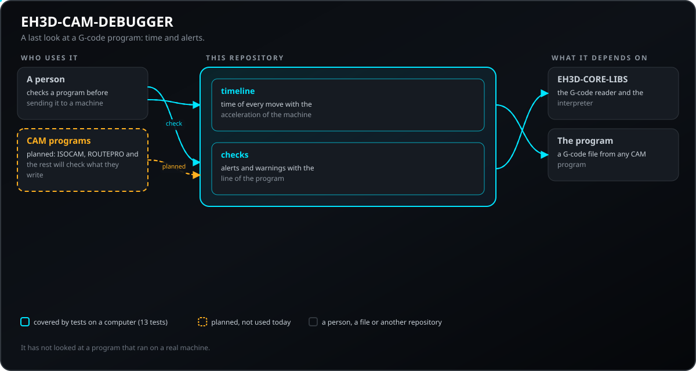
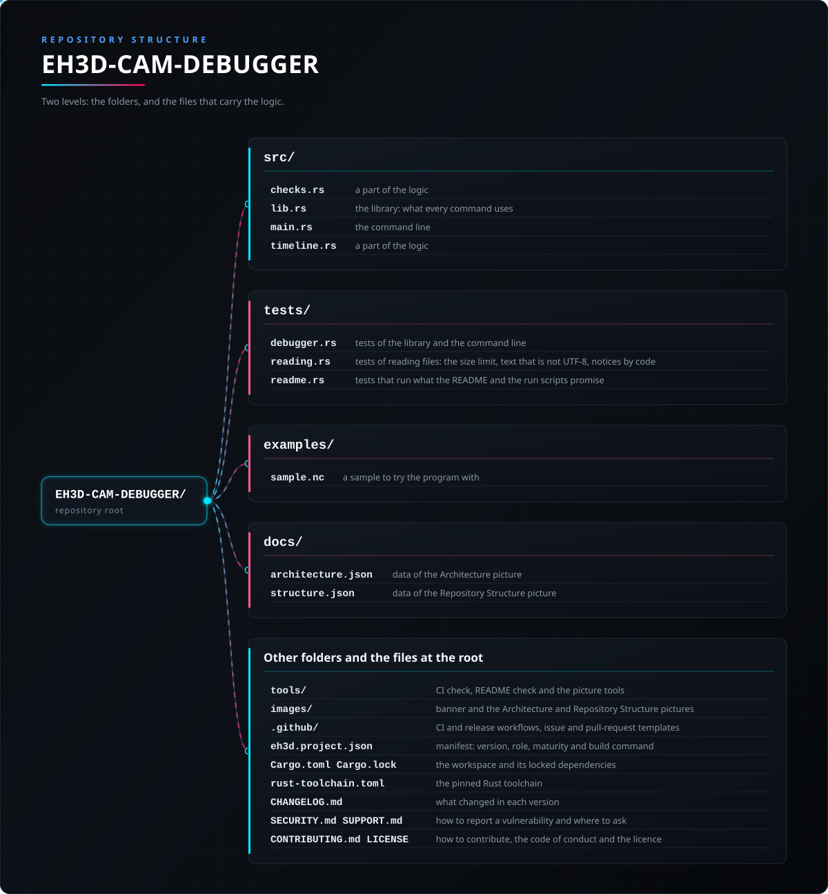

<p align="center">
  
</p>

#  EH3D-CAM-DEBUGGER
<p align="center"><a href="README.md">🇺🇸 English</a> | 🇪🇸 <b>Español</b> | <a href="README_fra.md">🇫🇷 Français</a> | <a href="README_ita.md">🇮🇹 Italiano</a> | <a href="README_deu.md">🇩🇪 Deutsch</a> | <a href="README_zho.md">🇨🇳 中文</a> | <a href="README_jpn.md">🇯🇵 日本語</a> | <a href="README_por.md">🇵🇹 Português</a></p>

### La última mirada a un programa G-code antes de llegar a una máquina: tiempo y alertas

<p align="center">
  
  
  
  
  
</p>

---

**Comprobación de honestidad - lo que funciona hoy:** una biblioteca Rust y un programa de línea de comandos (`eh3d-camdebug`) con 113 pruebas que se ejecutan en un ordenador: calcula el tiempo de un programa G-code y encuentra movimientos rápidos al material, movimientos fuera de la mesa, cortes con el husillo parado y cabezales sobre pinzas. Tiene una ventana (se compila con `--features gui`) que abre un programa G-code, dibuja su trayectoria en 2D, recorre los movimientos paso a paso con una tabla de líneas y muestra las alertas y advertencias, pero todavía no se ha visto en una pantalla; no se ha probado en una máquina y no se ha comprobado con una colección de ficheros reales.

---

> **Estado de seguridad:** este programa no controla ninguna máquina y no es un sistema de seguridad. Lo que produce debe revisarlo una persona antes de ejecutar nada en una máquina; nada de esto se ha ejecutado en hardware real.


## 📋 De un vistazo

| | |
|---|---|
| Versión | `0.0.5` |
| Madurez | Andamiaje |
| Pruebas | 113 |
| Pila tecnológica | Rust |
| En hardware real | No probado: nada de esto se ha ejecutado en una máquina |

**Ir a:** [Resumen](#-resumen) · [Arquitectura](#-arquitectura) · [Inicio rápido](#-inicio-rápido) · [Pruebas](#-pruebas) · [Estructura](#-estructura-del-repositorio) · [Relacionados](#-proyectos-relacionados)

## 🚦 Estado del proyecto

Cada línea es una parte de este repositorio y la luz dice hasta dónde llega hoy. Se escribe con lo que el repositorio puede demostrar (pruebas, compilaciones, ejecuciones), no con lo previsto.

🟢 Hecho y verificado · 🟡 Funciona, con límites conocidos · 🟠 Hecho a medias o sin verificar · 🔴 Sin hacer o sin funcionar

| Área | Estado | Qué significa aquí |
|---|---|---|
| Núcleo | 🟡 | calcula el tiempo de un programa G-code y encuentra movimientos rápidos al material, movimientos fuera de la mesa, cortes con el husillo parado y cabezales sobre pinzas; probado en un ordenador con entradas normales y dañadas, no con una colección de ficheros reales. |
| Línea de comandos | 🟡 | `eh3d-camdebug` ejecuta las mismas funciones que la biblioteca e imprime el resultado; cada error vuelve como mensaje y un código de salida distinto de cero. |
| Pruebas | 🟡 | 113 pruebas pasan (`cargo test`), con casos normales, casos límite y entradas dañadas. |
| Seguridad | 🟡 | Rust seguro y simple (`forbid(unsafe_code)`): nada entra en pánico con los ficheros recibidos y un valor malo es un error con su motivo; sin revisión independiente. |
| Ventana | 🟠 | Escrita (egui, `--features gui`): abrir o soltar un programa, ver su trayectoria en 2D, recorrer los movimientos paso a paso o reproducirlos, una tabla de movimientos, las alertas y advertencias, los ajustes de la máquina y los límites; su lógica está probada, pero todavía no se ha compilado ni visto en una pantalla. |
| Hardware real | 🔴 | No probado: nada de esto se ha ejecutado en una máquina. |
| Documentación | 🟡 | README en ocho idiomas, el registro de cambios y las dos imágenes dibujadas desde `docs/`. |

## 🎯 Resumen

* **El tiempo** (`src/timeline.rs`): cada movimiento es un trapecio de velocidad de reposo a reposo con la aceleración y la velocidad rápida de la máquina; los arcos se miden a lo largo del arco, un corte sin avance usa uno por defecto y el total se reparte en corte y rápido. Es una cota superior: un controlador real no se detiene entre movimientos. Las esperas de `G4` (`P` en segundos, en milisegundos en Marlin con `S` en segundos) no son movimientos y se suman aparte.
* **Las alertas** (`src/checks.rs`): un movimiento rápido (G0) al material o de lado bajo la superficie, un movimiento fuera de la mesa, una Z por debajo de la más baja de la máquina y un cabezal que pasa sobre una pinza por debajo de su altura son alertas (código de salida 1); un corte con el husillo parado, un corte sin avance y un avance por encima de un límite son avisos. Un movimiento recto se prueba de forma exacta contra cada abrazadera, así que se encuentra incluso una más fina que cualquier paso.
* **Lo que el lector no pudo entender** (compensación de radio, ciclos fijos, una línea dañada) aparece como alerta con su línea, de modo que un programa mal leído nunca se da por limpio.
* **Arcos, `--strict` y los códigos que mueven el origen:** los límites de la mesa y las bridas se comprueban a lo largo del arco de un G2 o G3, no de su cuerda; `--strict` convierte cada aviso en alerta (código de salida 1), para un flujo que usa el código de salida como barrera antes de la máquina; un programa con G92, G53, G28, G30 o G10 se señala en vez de pasar por limpio.
* **Lectura y avisos por código:** el programa se lee desde sus bytes (`--max-bytes N` rechaza un fichero que pasa del límite, 256 MiB por defecto; el texto que no es UTF-8 se lee como Latin-1 y se indica con el código `input-not-utf8`); cada hallazgo del lector muestra su código estable, y `--ignore CODE[,CODE]` omite los avisos de esos códigos.

## 🧩 Papel en EH3D

EH3D-CAM-DEBUGGER es un programa de la EH3D Fabrication Suite. Funciona como biblioteca y línea de comandos y, compilado con `--features gui`, como ventana con el aspecto que comparten los demás programas de la suite. Lee y escribe ficheros simples, así que puede usarse solo o entre los demás programas.

## 🏛️ Arquitectura

<p align="center">
  
</p>


Cómo encajan las partes de este repositorio: quién lo usa, qué contiene y de qué depende. La imagen se dibuja desde `docs/architecture.json` y se comprueba con el código.

## ✨ Funciones

* **Biblioteca y línea de comandos:** cada orden de `eh3d-camdebug` es una función de la biblioteca, así que otro programa de la suite puede llamarla sin lanzar un proceso.
* **Pruebas con entradas dañadas:** las pruebas también dan ficheros vacíos, basura, números enormes y ficheros cortados, y ninguna puede provocar un pánico.
* **Sin adivinar:** un valor que no tiene sentido es un error que dice cuál y por qué, nunca un resultado que solo lo parece.
* **Sin código unsafe:** `#![forbid(unsafe_code)]` en la biblioteca y el programa.
* **Un avance que falta se dice una vez y se lee el modo láser:** cada movimiento sin avance da un solo aviso (`--ignore feed-missing` lo silencia) y `--laser` lee `M3` o `M4` con `S0` como láser apagado.

## 🔒 Seguridad y protección

| Amenaza | Defensa |
|---|---|
| Un fichero dañado, cortado o vacío | sin pánico: las pruebas cortan una entrada válida en cada posición y dan basura |
| Un número sin sentido (negativo, no finito, absurdamente grande) | se rechaza con un error que nombra el valor; nada se redondea hasta parecer plausible |
| Uso inseguro de memoria | Rust seguro y simple con `forbid(unsafe_code)` |

**Lo que no se defiende:** un resultado producido sin errores no es un resultado verificado. Nada de esto conoce los límites de una máquina y el programa no ha tenido revisión independiente. Informe de una vulnerabilidad en privado (véase [SECURITY.md](SECURITY.md)).

## 🔌 Interfaces

La biblioteca es `eh3d_cam_debugger` (`use eh3d_cam_debugger::...`); la línea de comandos es `eh3d-camdebug`. Las órdenes son estas; cada una imprime su resultado por la salida estándar e informa de un error por la salida de errores con un código de salida distinto de cero. No hay acceso a la red.

```text
eh3d-camdebug check FILE.nc [options]     the time, the findings; exit code 1 when there is an alert, 2 when there are only warnings, 64 for a wrong option
eh3d-camdebug steps FILE.nc [options]     every move with its line, length and time
eh3d-camdebug [gui] [FILE.nc]             the window (a build with --features gui); with no arguments it opens
options: --accel MM_S2 (500)  --rapid MM_MIN (3000)  --feed MM_MIN (300)  --dialect grbl|marlin|planetcnc  --table WIDTH,DEPTH  --surface Z (0)  --min-z Z  --max-feed MM_MIN
         --laser  --clamp X0,Y0,X1,Y1,HEIGHT  --strict  --ignore CODE[,CODE]  --max-bytes N
```

## ⚙️ Configuración

Todavía no hay fichero de configuración: lo que elige la persona se da como argumentos de la línea de comandos (véase Interfaces) y cada valor por defecto está escrito en la ayuda de la orden (`eh3d-camdebug help`). Los límites fijos están en el código como constantes con nombre y las pruebas los cubren.

## 🚀 Inicio rápido

Necesita una cadena de herramientas Rust estable (1.88 o más reciente).

```bash
cargo build --release
cargo test
cargo run --release -- check examples/sample.nc --table 100,80 --clamp 20,-5,30,5,6
cargo run --release --features gui   # the window
```

## 🧪 Pruebas

El conjunto tiene 113 pruebas (`cargo test`, ejecutadas en Windows y Linux en el CI). Comprueban los casos normales, los casos límite y las entradas dañadas: ficheros vacíos, basura y ficheros cortados nunca provocan un pánico. El CI ejecuta además `cargo fmt --check`, `cargo clippy` con las advertencias como errores y `python -I tools/ci_validate.py`.

## 🏗️ Compilación y publicación

La versión está en `Cargo.toml` y en `eh3d.project.json`; cada versión tiene su entrada en [CHANGELOG.md](CHANGELOG.md). `build.bat` / `build.sh` compilan el programa, `test.bat` / `test.sh` ejecutan las pruebas y `run.bat` / `run.sh` lo ejecutan con un ejemplo. Las versiones se publican en GitHub.

**Descargas:** Con cada versión de este repositorio se publican programas ya hechos para cada sistema: Windows (64 y 32 bits), Linux (64 bits) y macOS (Apple silicon e Intel). Cada paquete, `cam-debugger-<versión>-<sistema>.zip` o `.tar.gz`, lleva el programa, la licencia, este README, el registro de cambios, el icono y los ficheros de ejemplo, y viene con su fichero `.sha256`; la versión también lista todos los ficheros en `SHA256SUMS` y `build-manifest.json`. Todavía no se ha publicado ninguna versión.

**Firmados y comprobables:** los paquetes de una versión se firman con la clave de versiones de EH3D, y el fichero `.sig` de cada paquete se publica a su lado (una firma OpenSSH, espacio de nombres `eh3d-release`). Comprueba una descarga antes de ejecutarla: compara su SHA-256 (`sha256sum -c cam-debugger-<versión>-<sistema>.tar.gz.sha256`, o `Get-FileHash` en Windows) y verifica la firma con `ssh-keygen -Y verify -f allowed_signers -I eh3d-release -n eh3d-release -s <paquete>.sig < <paquete>`, donde `allowed_signers` contiene la línea `eh3d-release <tipo de clave> <clave pública de las versiones de EH3D>`.

## 📂 Estructura del repositorio

<p align="center">
  
</p>

<details>
<summary>Versión en texto del árbol</summary>

```text
EH3D-CAM-DEBUGGER/
├── src/
│   ├── checks.rs                                una parte de la lógica
│   ├── lib.rs                                   la biblioteca: lo que usa cada orden
│   ├── main.rs                                  la línea de comandos
│   ├── timeline.rs                              una parte de la lógica
│   ├── browse.rs                                la lista de ficheros de la ventana que abre un fichero
│   ├── gui.rs                                   la ventana (egui, con la característica gui): dibuja el estado y transmite lo que hace la persona
│   ├── lang.rs                                  las palabras de la ventana en los ocho idiomas
│   ├── viewport.rs                              zoom y desplazamiento de la imagen, en números simples
│   └── window.rs                                el estado de la ventana sin pantalla: programa, ajustes, movimientos y pasos
├── tests/
│   ├── debugger.rs                              pruebas de la biblioteca y la línea de comandos
│   ├── reading.rs                               pruebas de lectura de ficheros: el límite de tamaño, texto que no es UTF-8, avisos por código
│   ├── readme.rs                                pruebas que ejecutan lo que prometen el README y los scripts run
│   └── window_cli.rs                            pruebas de que una compilación sin la característica gui sigue siendo solo línea de comandos
├── examples/
│   └── sample.nc                                una muestra para probar el programa
├── docs/
│   ├── architecture.json                        datos de la imagen de Arquitectura
│   └── structure.json                           datos de la imagen de Estructura
├── tools/                                       comprobación del CI y del README y herramientas de imágenes
├── images/                                      banner y las imágenes de Arquitectura y Estructura del repositorio
├── .github/                                     flujos de CI y de publicación, plantillas de issues y pull requests
├── eh3d.project.json                            manifiesto: versión, rol, madurez y comando de compilación
├── Cargo.toml Cargo.lock                        el workspace y sus dependencias fijadas
├── rust-toolchain.toml                          la toolchain de Rust fijada
├── CHANGELOG.md                                 qué cambió en cada versión
├── SECURITY.md SUPPORT.md                       cómo informar de una vulnerabilidad y dónde preguntar
└── CONTRIBUTING.md CODE_OF_CONDUCT.md LICENSE   cómo contribuir, el código de conducta y la licencia
```

</details>

## 🗺️ Hoja de ruta y límites conocidos

**Límites conocidos hoy**

* La ventana todavía no se ha visto en una pantalla; muestra la trayectoria desde arriba (sin vista 3D) y los textos de los hallazgos son los de la biblioteca, en inglés.
* No se ha probado en una máquina ni con una colección de ficheros reales y no ha tenido revisión independiente.
* Todavía no hay simulación 3D ni retirada de material, y las pinzas son cajas que se describen a mano.

**Siguiente**

* Simular la retirada de material en 3D y comparar el resultado con la pieza, con la ventana de la suite.
* Ver la ventana en una pantalla y terminarla.
* Probarlo con ficheros reales y con los demás programas de la suite.

## 🌍 Idiomas

El README y los textos existen en inglés, español, francés, italiano, alemán, chino, japonés y portugués de Portugal.

## 🔗 Proyectos relacionados

* [EH3D-CORE-LIBS](https://github.com/JuanenRac/EH3D-CORE-LIBS): los lectores de Gerber, Excellon y G-code
* [EH3D-ISOCAM](https://github.com/JuanenRac/EH3D-ISOCAM): el fresado de aislamiento del cobre
* [EH3D-ROUTEPRO](https://github.com/JuanenRac/EH3D-ROUTEPRO): el programa de fresado de contorno
* [EH3D-AUTOLEVEL](https://github.com/JuanenRac/EH3D-AUTOLEVEL): el mapa de alturas y la corrección del G-code
* [EH3D-PHOENIX-CNC](https://github.com/JuanenRac/EH3D-PHOENIX-CNC): el programa de control de máquina

## 📚 Documentación

* [Registro de cambios](CHANGELOG.md)
* [Datos de arquitectura y estructura](docs/architecture.json): los datos con los que se dibujan las dos imágenes.

## 🤝 Contribuir y comunidad

* Antes de una pull request ejecute `cargo fmt --check`, `cargo clippy --all-targets -- -D warnings`, `cargo test` y `python -I tools/ci_validate.py`: todo debe pasar. Véanse [CONTRIBUTING.md](CONTRIBUTING.md) y el [código de conducta](CODE_OF_CONDUCT.md).
* El README existe en ocho idiomas: un cambio de texto se hace en los ocho ficheros, y las dos imágenes se dibujan desde `docs/architecture.json` y `docs/structure.json` con `tools/make_architecture.py` y `tools/make_structure.py`.
* Informe de una vulnerabilidad en privado: [SECURITY.md](SECURITY.md). Preguntas, ideas e informes: electrohobby3d@gmail.com ([SUPPORT.md](SUPPORT.md)).

## 👤 AUTOR

**JuanenRac (Electro Hobby 3D)** · electrohobby3d@gmail.com

## 📜 LICENCIA

Software: GPL-3.0-or-later. Véase [LICENSE](LICENSE). Los diseños de hardware de la suite usan CERN OHL-S.
