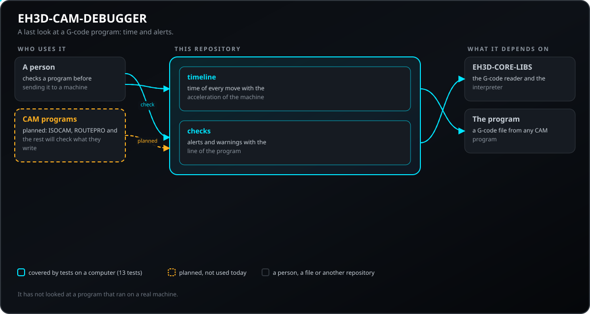
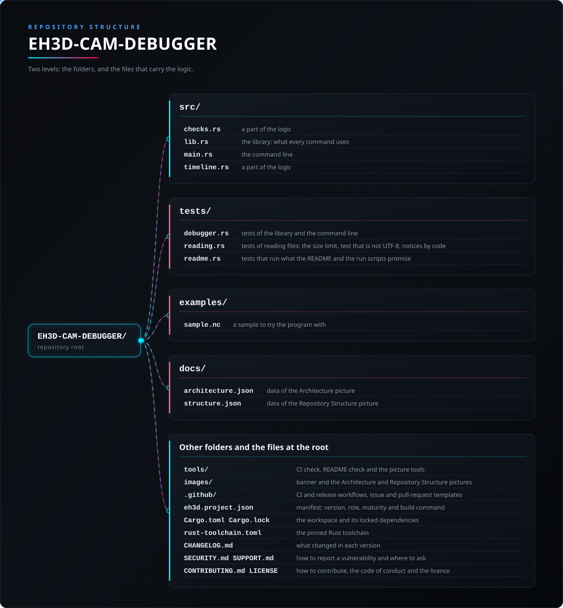

<p align="center">
  
</p>

# 📖 EH3D-CAM-DEBUGGER

<p align="center"><a href="README.md">🇺🇸 English</a> | <a href="README_spa.md">🇪🇸 Español</a> | <a href="README_fra.md">🇫🇷 Français</a> | <a href="README_ita.md">🇮🇹 Italiano</a> | <a href="README_deu.md">🇩🇪 Deutsch</a> | 🇨🇳 <b>中文</b> | <a href="README_jpn.md">🇯🇵 日本語</a> | <a href="README_por.md">🇵🇹 Português</a></p>

### G 代码程序到达机器之前的最后检查：时间和警报

<p align="center">
  
  
  
  
  
</p>

---

**诚实检查 - 当前真正能运行的内容：** 一个 Rust 库和一个命令行程序（`eh3d-camdebug`），有 13 个在电脑上运行的测试：计算 G 代码程序的时间，并找出快速进入材料、超出工作台、主轴停转时切削以及刀头经过夹具的情况。目前还没有窗口，没有在机器上试过，也没有用大量真实文件验证过。

---

> **安全状态：** 本程序不控制任何机器，也不是安全系统。它的输出在机器上运行之前必须由人检查；这里的任何内容都没有在真实硬件上运行过。


## 📋 速览

| | |
|---|---|
| 版本 | `0.0.2` |
| 成熟度 | 脚手架 |
| 测试 | 13 |
| 技术栈 | Rust |
| 真实硬件 | 未试过：这里的任何内容都没有在机器上运行过 |

**跳转到：** [概述](#-概述) · [架构](#-架构) · [快速开始](#-快速开始) · [测试](#-测试) · [结构](#-仓库结构) · [相关项目](#-相关项目)

## 🚦 项目状态

每一行是本仓库的一个部分，灯号表示它今天做到了哪一步。内容依据仓库能够展示的证据（测试、构建、运行），而不是计划。

🟢 已完成并验证 · 🟡 可用，有已知限制 · 🟠 部分完成或尚未验证 · 🔴 未完成或不可用

| 领域 | 状态 | 在这里的含义 |
|---|---|---|
| 核心 | 🟡 | 计算 G 代码程序的时间，并找出快速进入材料、超出工作台、主轴停转时切削以及刀头经过夹具的情况；已在电脑上用正常和损坏的输入测试，未用大量真实文件验证。 |
| 命令行 | 🟡 | `eh3d-camdebug` 运行与库相同的函数并打印结果；每个错误都以消息和非零退出码返回。 |
| 测试 | 🟡 | 13 个测试通过（`cargo test`），包含正常情况、边界情况和损坏的输入。 |
| 安全 | 🟡 | 纯安全 Rust（`forbid(unsafe_code)`）：处理收到的文件时不会 panic，错误的值会返回带原因的错误；没有独立审查。 |
| 窗口 | 🔴 | 计划中：套件通用的 egui 窗口；目前只有命令行。 |
| 真实硬件 | 🔴 | 未试过：这里的任何内容都没有在机器上运行过。 |
| 文档 | 🟡 | 八种语言的 README、更新日志，以及由 `docs/` 绘制的两张图。 |

## 🎯 概述

* **时间**（`src/timeline.rs`）：每次移动按机器的加速度和快速速度，用从静止到静止的速度梯形计算；圆弧沿弧长计量，没有进给的切削使用默认进给，总时间分为切削和快速两部分。这是上限值：真实的控制器在移动之间不会停下。
* **警报**（`src/checks.rs`）：快速移动（G0）进入材料或在表面下横向移动、超出工作台、Z 低于机器最低值，以及刀头低于夹具高度从其上方经过，都是警报（退出码 1）；主轴停转时切削、没有进给的切削和超过限值的进给是警告。
* **读取器无法理解的内容**（刀具半径补偿、固定循环、损坏的行）会作为带行号的警报出现，因此被误读的程序绝不会被报告为没有问题。
* **圆弧、`--strict` 与会移动原点的代码：** 工作台范围和压板沿 G2 或 G3 的圆弧检查，而不是沿其弦；`--strict` 把每个警告都变成警报（退出码 1），适合把退出码当作机床前关卡的流程；含有 G92、G53、G28、G30 或 G10 的程序会被报告，而不是当作干净通过。

## 🧩 在 EH3D 中的角色

EH3D-CAM-DEBUGGER 是 EH3D Fabrication Suite 的一个程序。目前它以库和命令行的形式工作；与套件其他程序外观一致的窗口在计划中。它读写简单的文件，因此可以单独使用，也可以用在其他程序之间。

## 🏛️ 架构

<p align="center">
  
</p>


本仓库各部分如何配合：谁使用它、它包含什么、它依赖什么。图由 `docs/architecture.json` 绘制并与代码核对。

## ✨ 功能

* **库加命令行：** `eh3d-camdebug` 的每个命令都是库中的函数，套件中的其他程序无需启动进程即可调用。
* **损坏输入的测试：** 测试还会输入空文件、乱码、巨大数字和被截断的文件，任何情况都不允许 panic。
* **不猜测：** 没有意义的值是一个说明哪个值、为什么的错误，绝不是只是看起来正确的结果。
* **没有 unsafe 代码：** 库和程序中都有 `#![forbid(unsafe_code)]`。

## 🔒 安全与防护

| 威胁 | 防御 |
|---|---|
| 损坏、被截断或为空的文件 | 不会 panic：测试在每个位置截断有效输入并输入乱码 |
| 没有意义的数字（负数、非有限值、过大的数） | 以指出该值的错误拒绝；不会被舍入成看似合理的值 |
| 不安全的内存使用 | 带 `forbid(unsafe_code)` 的纯安全 Rust |

**没有防御的内容：** 无错误产生的结果不等于经过验证的结果。这里没有任何内容了解机器的极限，程序也没有经过独立审查。请私下报告漏洞（见 [SECURITY.md](SECURITY.md)）。

## 🔌 接口

库为 `eh3d_cam_debugger`（`use eh3d_cam_debugger::...`），命令行为 `eh3d-camdebug`。命令如下；每个命令把结果打印到标准输出，把错误以非零退出码报告到标准错误。没有网络访问。

```text
EH3D-CAM-DEBUGGER/
├── src/
│   ├── checks.rs                                逻辑的一部分
│   ├── lib.rs                                   库：每个命令所使用的部分
│   ├── main.rs                                  命令行
│   └── timeline.rs                              逻辑的一部分
├── tests/
│   └── debugger.rs                              库和命令行的测试
├── examples/
│   └── sample.nc                                试用的示例
├── docs/
│   ├── architecture.json                        架构图数据
│   └── structure.json                           结构图数据
├── tools/                                       CI 和 README 检查及绘图工具
├── images/                                      横幅图以及架构和仓库结构图片
├── .github/                                     CI 与发布工作流、Issue 和 PR 模板
├── eh3d.project.json                            清单：版本、角色、成熟度和构建命令
├── Cargo.toml Cargo.lock                        工作区及其锁定的依赖
├── CHANGELOG.md                                 每个版本的变更
├── SECURITY.md SUPPORT.md                       如何报告漏洞及在哪里提问
└── CONTRIBUTING.md CODE_OF_CONDUCT.md LICENSE   参与贡献、行为准则和许可证
```

## ⚙️ 配置

目前还没有配置文件：用户的选择通过命令行参数给出（见接口），每个默认值都写在命令的帮助中（`eh3d-camdebug help`）。固定的限制是代码中的具名常量，并有测试覆盖。

## 🚀 快速开始

需要稳定版 Rust 工具链（1.75 或更新）。

```bash
cargo build --release
cargo test
cargo run --release -- check examples/sample.nc --table 100,80 --clamp 20,-5,30,5,6
```

## 🧪 测试

测试套件有 13 个测试（`cargo test`，CI 在 Windows 和 Linux 上运行）。它们检查正常情况、边界情况和损坏的输入：空文件、乱码和被截断的文件绝不会 panic。CI 还运行 `cargo fmt --check`、把警告当作错误的 `cargo clippy` 以及 `python -I tools/ci_validate.py`。

## 🏗️ 构建与发布

版本号位于 `Cargo.toml` 和 `eh3d.project.json`；每个版本在 [CHANGELOG.md](CHANGELOG.md) 中都有条目。`build.bat` / `build.sh` 构建程序，`test.bat` / `test.sh` 运行测试，`run.bat` / `run.sh` 用示例运行。版本发布在 GitHub 上。

## 📂 仓库结构

<p align="center">
  
</p>

<details>
<summary>目录树的文本版</summary>

```text
EH3D-CAM-DEBUGGER/
├── crates/
│   ├── eh3d-parser-gerber/                      Gerber RS-274X 读取器
│   ├── eh3d-parser-excellon/                    Excellon 钻孔文件读取器
│   └── eh3d-parser-gcode/                       G 代码读取器和模态解释器
├── docs/                                        READERS.md：每个读取器的承诺和不做的事，以及两张图的数据
├── tools/                                       CI 和 README 检查及绘图工具
├── images/                                      横幅图以及架构和仓库结构图片
├── .github/                                     CI 与发布工作流、Issue 和 PR 模板
├── eh3d.project.json                            清单：版本、角色、成熟度和构建命令
├── Cargo.toml Cargo.lock                        工作区及其锁定的依赖
├── CHANGELOG.md                                 每个版本的变更
├── SECURITY.md SUPPORT.md                       如何报告漏洞及在哪里提问
└── CONTRIBUTING.md CODE_OF_CONDUCT.md LICENSE   参与贡献、行为准则和许可证
```

</details>

## 🗺️ 路线图与已知限制

**目前已知的限制**

* 还没有窗口：只有库和命令行。
* 没有在机器上试过，也没有用大量真实文件验证过，也没有独立审查。
* 还没有 3D 模拟和材料去除，夹具是需要手工描述的长方体。

**下一步**

* 在套件窗口中以 3D 模拟材料去除，并把结果与零件对比。
* 添加与套件程序外观一致、支持八种语言的窗口。
* 用真实文件和套件的其他程序进行试用。

## 🌍 语言

README 和文本提供英语、西班牙语、法语、意大利语、德语、汉语、日语和欧洲葡萄牙语版本。

## 🔗 相关项目

* [EH3D-CORE-LIBS](https://github.com/JuanenRac/EH3D-CORE-LIBS): Gerber、Excellon 和 G 代码的读取器
* [EH3D-ISOCAM](https://github.com/JuanenRac/EH3D-ISOCAM): 铜箔隔离铣削
* [EH3D-ROUTEPRO](https://github.com/JuanenRac/EH3D-ROUTEPRO): 轮廓铣削程序
* [EH3D-AUTOLEVEL](https://github.com/JuanenRac/EH3D-AUTOLEVEL): 高度图和 G 代码修正
* [EH3D-MOTIONCNC](https://github.com/JuanenRac/EH3D-MOTIONCNC): 机器控制程序

## 📚 文档

* [更新日志](CHANGELOG.md)
* [架构与结构数据](docs/architecture.json)：绘制两张图所用的数据。

## 🤝 参与贡献与社区

* 提交拉取请求前请运行 `cargo fmt --check`、`cargo clippy --all-targets -- -D warnings`、`cargo test` 和 `python -I tools/ci_validate.py`：必须全部通过。见 [CONTRIBUTING.md](CONTRIBUTING.md) 和[行为准则](CODE_OF_CONDUCT.md)。
* README 有八种语言：修改文字要在八个文件中同时进行，两张图由 `tools/make_architecture.py` 和 `tools/make_structure.py` 根据 `docs/architecture.json` 和 `docs/structure.json` 绘制。
* 请私下报告漏洞：[SECURITY.md](SECURITY.md)。问题、想法和报告：electrohobby3d@gmail.com（[SUPPORT.md](SUPPORT.md)）。

## 👤 作者

**JuanenRac (Electro Hobby 3D)** · electrohobby3d@gmail.com

## 📜 许可证

软件：GPL-3.0-or-later。见 [LICENSE](LICENSE)。套件的硬件设计使用 CERN OHL-S。
